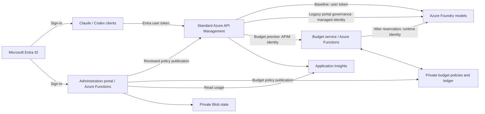

# Claude & Codex on Azure

**Claude Chat, Claude Code, and Codex Desktop/CLI through Azure Foundry and standard Azure API Management.**

Give developers a familiar Claude experience with Microsoft Entra sign-in. Deploy the infrastructure in your Azure subscription, distribute a Mac installer, and manage access and usage through a customer-owned administration portal. No shared inference API key or separate AI Gateway resource is required.

**Team repository:** use this repository for source code, documentation, issues, and pull requests. Access is managed by the GitHub organization.

[Install on a Mac](docs/macos.md) · [Deploy for your organization](docs/administrator.md) · [Explore the portal](docs/portal-guide.md) · [Contribute](CONTRIBUTING.md)

> **Codex and content-log preview:** included in `main`, Codex Desktop/CLI routes to Azure OpenAI models through a separate standard APIM API. It includes Entra sign-in, model qualification, Mac onboarding, restore, and a readable-history handoff for existing conversations. [Setup and limitations](docs/codex.md) · [Validation record](docs/codex-validation.md). The baseline management portal policy remains Claude-only; the optional budget gateway adds shared Claude/Codex policy. Optional [content logs](docs/content-logs.md) support both clients.

> **Budget hierarchy preview:** included in `main` for evaluation, the optional budget gateway adds organization, group and user USD limits and delegated group administrators. Customer release checks remain outstanding. [Azure architecture and request-flow diagram](docs/budget-architecture.md) · [Budget rules](docs/budget-enforcement.md) · [Completed Azure tests and remaining checks](docs/budget-validation.md). Existing endpoints do not acquire dollar enforcement automatically.

> **Portal preview:** the management portal is included for continued development and evaluation. By default it reports on and manages the same Claude API used by clients; an isolated API is an explicit testing option. Attaching the portal does not publish access rules automatically. See the [validation record and remaining production checks](portal/VALIDATION.md) before planning a customer rollout. Merging source does not deploy Azure resources.


*Captured from the running Azure-hosted preview on October 14, 2026. Real verification traffic; planning estimates, not an Azure invoice. [See the complete feature tour](docs/portal-guide.md).*

## What you can do

| For | Capabilities |
| --- | --- |
| **Developers** | Use Desktop Chat, Desktop Code, and the Code CLI with organization models. Sign in with Microsoft. Install without Azure CLI using an MSAL profile. Restore previous Claude settings when needed. |
| **Platform teams** | Deploy Foundry, standard APIM, and monitoring; discover eligible Anthropic models; publish a model catalog; build organization-specific Mac installation bundles. |
| **Portal administrators** | Register members, import CSVs, assign groups and model grants, review access requests, and publish token quotas and rate limits to a dedicated gateway API. |
| **Finance and operations** | Explore usage by model, group, and developer; combine filters; compare periods; export CSVs; maintain sourced planning rates and dollar thresholds. |
| **Security reviewers** | Inspect Entra authentication, API-enforced roles, managed identities, private portal storage, policy publication, and administrative audit records. |

The portal manages gateway access and operational metadata. Entra remains responsible for directory accounts and sign-in policy; Azure Cost Management remains responsible for billed spend. Optional [prompt and response logs](docs/content-logs.md) let owners and administrators inspect newly captured gateway messages with audited access. Capture is off by default; this is not a full conversation archive.

## Choose your starting point

### I want to use Claude on my Mac

Ask your organization for its installation ZIP. You do **not** need an Azure subscription, Git checkout, or infrastructure deployment permissions.

1. Install your organization's approved Claude Desktop and, if needed, Claude Code CLI.
2. Extract the organization ZIP and open `Install.command`.
3. Complete Microsoft sign-in, then fully quit and reopen Claude Desktop.
4. Select the organization profile and a published model. Send a small test message.

The installer supplies its own isolated runtime and preserves unrelated settings. An MSAL profile requires no Azure CLI. To bring existing work into the Azure profile, use the opt-in [conversation import workflow](docs/conversation-migration.md). Originals stay available.

**[Mac installation, verification, and restore →](docs/macos.md)**

### I want to deploy this for my organization

An Azure administrator deploys the shared foundation once. An Entra administrator may also be needed for app registration and consent. Start with a small pilot and your own reviewed configuration.

One settings file and one command deploy Foundry, API Management, Claude, Codex and the portal, then build a single developer installer:

```bash
git clone https://github.com/msftse-org/claude-codex-foundry.git
cd claude-codex-foundry
uv sync --frozen --extra auth --extra portal
mkdir -p .local && cp examples/deploy.json .local/deploy.json   # edit tenant, subscription, suffix, Marketplace details
az login --tenant YOUR_TENANT_ID
uv run python scripts/deploy.py --settings .local/deploy.json
uv run python scripts/onboard_users.py alice@contoso.com bob@contoso.com
```

Send developers the ZIP from `dist/`. **[Quick start →](docs/quickstart.md)**

The [administrator guide](docs/administrator.md) explains each step the script runs, for existing infrastructure or step-by-step control:

1. Confirm subscription eligibility, regions, permissions, and Marketplace details.
2. Deploy new infrastructure, or configure a dedicated API on existing APIM/Foundry resources.
3. Discover eligible models, review paid terms, deploy, and verify inference.
4. Publish **Claude via Azure Foundry** in APIM and connect observability.
5. Choose Azure CLI or MSAL sign-in, export a client profile, and build the Mac ZIP.
6. Optionally deploy the [management portal](portal/README.md#azure-deployment) on the same Claude route.

Model availability and quota depend on the subscription, region, and deployment type. Catalog discovery is not a guarantee that a model can be purchased or invoked.

**[Organization deployment guide →](docs/administrator.md)**

### I want to evaluate the management portal

Start with the [visual walkthrough](docs/portal-guide.md), then follow the [Azure preview deployment guide](portal/README.md). The portal is a single-tenant application hosted in your subscription. There is no shared hosted service to sign up for.


*Portal roles and suspension apply on save. Inference access changes are saved as drafts and require reviewed publication before gateway enforcement changes.*

## How it fits together



Each API route uses one of these authorization modes. A client profile must point to the intended route:

| Mode | Where inference access is decided | When to use |
| --- | --- | --- |
| **Baseline gateway** | APIM validates the user token; Foundry applies the user's inference RBAC. One published model allowlist applies to callers. | Establish the gateway and Mac onboarding without the portal. |
| **Portal governance preview** | APIM validates the user token and enforces published membership, model grants, and token limits. APIM's managed identity calls Foundry. | Add administration to the existing Claude route after reviewing and publishing access rules. Use an isolated API only when explicitly testing. |
| **Budget hierarchy preview** | APIM establishes identity; a separate budget Function checks published permissions and atomically reserves organization/group/user USD allowance before its managed identity calls Foundry. | Evaluate shared Claude/Codex dollar enforcement on dedicated budget routes. Requires separate deployment and release validation. |

The portal is outside the inference path. The budget Function and its storage are dependencies for every governed inference request; the portal is needed for administration and publication. Users with direct Foundry RBAC can bypass gateway controls; review that access when adopting governance.

**Who checks identity, where is money reserved, and what happens during an outage?** Read the [Azure service walkthrough and complete request-flow diagram](docs/budget-architecture.md), including the storage map, permissions, concurrent requests and failure handling. The [security model](docs/security.md) describes the baseline boundaries.

## Costs and practical limits

- **Azure charges apply.** APIM has an ongoing service charge; inference and monitoring are metered. The portal uses Functions Flex Consumption with no always-ready instances, but storage, private endpoints, DNS, and logs can still incur charges.
- **Hard dollar enforcement remains a release gate.** The optional budget gateway adds a shared reservation ledger for Claude/Codex and scoped group administrators, with organization, group and user USD limits—including owner requests. It requires a separate deployment; existing routes and planning amounts remain unchanged. See [the hierarchy, failure behavior and acceptance checks](docs/budget-enforcement.md).
- **Cost analysis is an estimate.** Rates are maintained by administrators. Cache pricing, some prompt-length tiers, discounts, tax, and infrastructure costs are not reconciled. See the [pricing reference](portal/PRICING.md).
- **Scale must be measured.** A 2,000-member import/policy-size check has passed; 2,000 concurrent developers have not been load-tested.
- **Current onboarding targets macOS and Azure public cloud.** The baseline inference endpoints are public HTTPS. Private portal storage does not make Foundry or APIM private. Conversation import uses Claude's native wizard with documented source and attachment limits. Windows/Linux installers, SCIM, MDM enrollment, and immutable compliance archives are not included.

## Documentation

| Task | Guide |
| --- | --- |
| Deploy everything with one command and onboard developers | [Quick start](docs/quickstart.md) |
| Deploy infrastructure, models, and the gateway | [Organization administrator](docs/administrator.md) |
| Install, sign in, update, or restore Claude settings | [Mac installation](docs/macos.md) |
| Bring existing chats, projects, and local sessions | [Conversation migration](docs/conversation-migration.md) |
| Configure Codex Desktop/CLI, OpenAI models and existing-work handoff | [Codex on Azure](docs/codex.md) |
| Learn every portal workspace with real screenshots | [Portal guide and gallery](docs/portal-guide.md) |
| Deploy or develop the portal | [Portal engineering guide](portal/README.md) |
| Operate, upgrade, recover, and plan a rollout | [Operations guide](docs/operations.md) |
| Query requests, errors, and token metrics | [Observability](docs/observability.md) |
| Enable and inspect restricted prompt/response capture | [Content logs](docs/content-logs.md) |
| Review identities, data, and trust boundaries | [Security architecture](docs/security.md) |
| Understand sign-in, roles, Azure RBAC, and publication | [Identity and permissions](docs/identity-and-permissions.md) |
| Follow a budgeted request through Azure, from sign-in to settlement | [Budget architecture and service diagram](docs/budget-architecture.md) |
| Configure USD limits, delegated group administration and recovery | [Budget enforcement](docs/budget-enforcement.md) |
| Diagnose errors | [Troubleshooting](docs/troubleshooting.md) |
| Understand scope and common questions | [FAQ](docs/faq.md) |
| Make a code or documentation contribution | [Contributing](CONTRIBUTING.md) |

## Support and contribution

For installation and access problems, contact your organization's platform team first. For reproducible project defects or feature proposals, [open an issue](https://github.com/msftse-org/claude-codex-foundry/issues/new/choose) with sanitized details. Use the [security reporting guidance](SECURITY.md) for vulnerabilities.

Contributions are welcome through focused pull requests. [CONTRIBUTING.md](CONTRIBUTING.md) covers local setup, validation, architecture, documentation, and the review process. CI validates changes; it does not deploy them.

**Project and licensing status:** this repository is independently maintained and does not provide Microsoft or Anthropic product support or certification. No open-source license has been selected yet; public visibility alone is not a redistribution license. Confirm the project's licensing terms before redistributing it to customers. Azure and Anthropic service terms apply separately.
