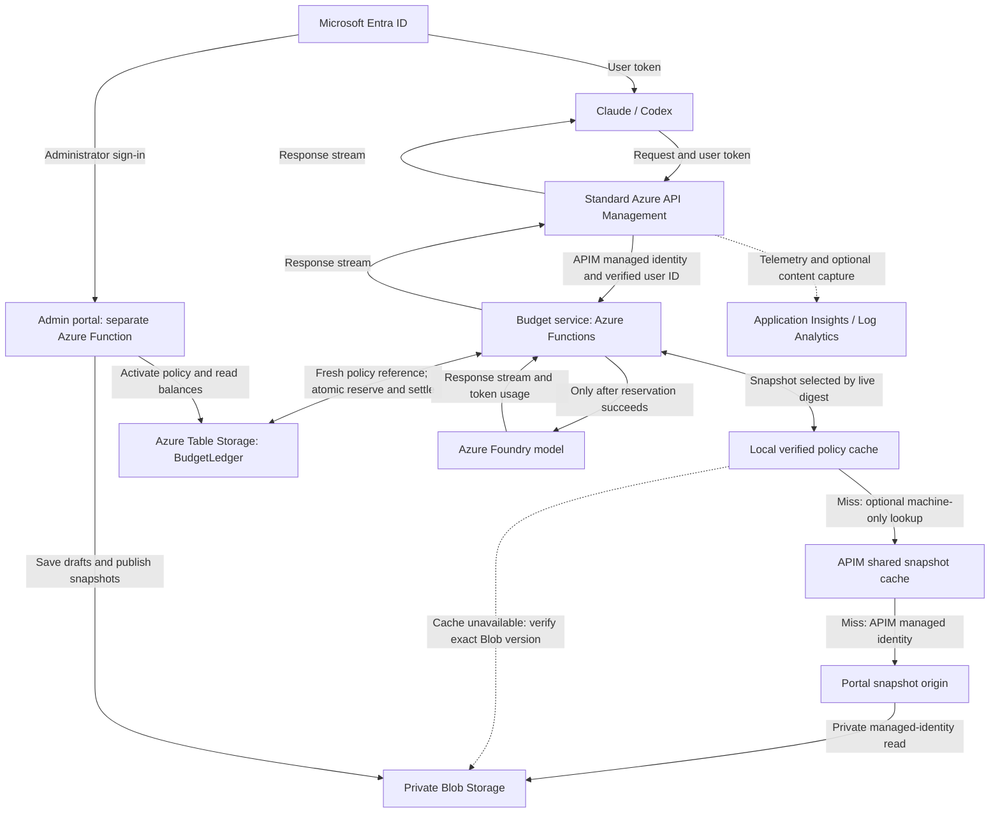

# How a budgeted request travels through Azure

[← README](../README.md) · [Budget rules and recovery](budget-enforcement.md) · [Deployment](../budget/README.md) · [Validation status](budget-validation.md)

> **Unreleased preview — `codex/budget-hierarchy`.** This describes the dedicated budget routes for Claude and Codex. Deploying the baseline gateway or entering a planning budget does not enable this flow. Complete the [release checks](budget-enforcement.md#release-acceptance) and remove alternate inference paths before customer rollout.

## What is the budget service?

The budget service is this repository's custom Python application, hosted in a separate **Azure Functions Flex Consumption app** in your subscription. It runs between standard Azure API Management (APIM) and Azure Foundry. For each inference request, it checks access, reserves allowance, calls the model, streams the answer back, and records the charge.

The administration portal is a second Function app. It lets authorized administrators manage and publish policy. Azure Cost Management provides billing information and alerts; it does not perform the per-request admission described here.

## The Azure services and their responsibilities



| Service | What it checks or stores |
| --- | --- |
| Microsoft Entra ID | Authenticates people and issues tokens for users and managed identities. Customer Conditional Access policies still apply. |
| Standard APIM | Validates the workstation token, establishes the caller's object ID, creates the request ID, and authenticates itself to the budget service. |
| Budget Function | Authorizes the user/model, checks reviewed pricing and supported features, reserves all applicable allowances, forwards inference, and settles usage. |
| Private Blob Storage | Stores portal drafts, administrative audit history and immutable published policy snapshots. |
| Private Azure Table Storage | Stores the active policy reference, monthly monetary counters and per-request reservations/settlements. |
| Azure Foundry | Authorizes the budget service's managed identity and runs the selected deployed model. |
| Admin portal Function | Checks administrator permissions, saves reviewed changes and activates the appropriate organization or team policy. |
| Application Insights / Log Analytics | Store operational telemetry and, when enabled, restricted prompt/response capture. These records are not the budget admission authority. |

## One model request, step by step

### 1. The workstation sends its Entra token to APIM

Claude or Codex obtains a delegated Cognitive Services token through the configured Azure CLI or lightweight MSAL sign-in helper. The client sends it to the organization's dedicated budget API. The default preview paths are `/claude-budget-preview` and `/codex-budget-preview`.

The developer does not receive a storage credential, Foundry key or permission to edit the ledger. In this mode, developers do not need direct Foundry inference RBAC.

The flow below covers billable inference. Model-catalog and balance requests are authenticated reads. Supported Anthropic token-count requests check model access but do not reserve inference allowance; their estimates are not used as the monetary admission bound.

### 2. APIM establishes the caller's identity

APIM validates the token against the configured Entra tenant and audience. It extracts the signed `oid` claim and overwrites `x-budget-principal-id` with that object ID. It also overwrites `x-budget-request-id` with APIM's request ID and removes client-supplied group and API-key headers.

The user cannot choose another person's identity or group by sending headers. APIM forwards the request using its own managed-identity token for the budget service's dedicated audience.

### 3. The budget service verifies APIM and loads policy

The Function validates the incoming token's signature, issuer, tenant, audience, lifetime and exact APIM managed-identity object ID. It rejects delegated user tokens at this backend. Only after that check does it trust the identity headers supplied by APIM.

It reads the active policy digest and pause state from `BudgetLedger` on every authorization. The matching immutable snapshot is loaded from the process-local cache, then the optional APIM shared cache, with an exact-version Blob fallback. Every newly loaded document is hash-verified before use. From that policy it resolves the active member, their group and their model grants. Group identity never comes from a workstation-supplied value. The active digest and pause state are never cached.

### 4. The service validates the request and reserves its maximum charge

The service requires a current reviewed rate and capacity for the model. It compares the reviewed provider/version/capacity against the deployment metadata configured on the service. It enforces an output-token bound and rejects unsupported paid features, including premium tiers and server tools.

This comparison is against operator-configured metadata; the service does not rediscover Foundry deployment settings or market prices on every request. Operators must pin the actual deployment and keep its reviewed metadata and rates accurate. Missing or expired verification blocks inference.

The reservation uses **the full verified input capacity plus the request's enforced output maximum**, at conservative reviewed rates. It does not rely on a prompt-token estimate to authorize a smaller amount.

For each of the organization, group and user scopes, admission requires:

```text
spent + already reserved + new request reservation <= monthly limit
```

All three counters, the new reservation and the active-policy version check commit in one Azure Table transaction within the organization's partition. ETag conditions reject stale updates. If another request or publication wins the race, the service checks again; if it cannot commit safely, it refuses the request. Multiple Function instances use the same durable counters.

No model call is dispatched until the reservation transaction succeeds. Ownership grants no exemption from these limits.

### 5. The service calls Foundry using its managed identity

The budget service calls the fixed Foundry endpoint with its own managed-identity token. Its identity has the **Cognitive Services User** role scoped to the configured Foundry account. Foundry authorizes that identity; the budget service supplies the individual user/group authorization and dollar checks.

The service forwards Anthropic Messages or OpenAI Responses and streams the answer through APIM to the client. It does not automatically retry a model dispatch with an uncertain outcome. A client retry is a new gateway request and must obtain its own reservation.

### 6. Provider usage settles the reservation

For streaming requests, the service parses terminal usage events while forwarding response chunks. For non-streaming responses, it reads the returned usage. It calculates a charge at the same reviewed conservative rates, then atomically updates all three counters and the reservation:

```text
reserved -= original reservation
spent    += calculated charge
request   = settled
```

Settlement is idempotent for the same request and amount. A conflicting second settlement is rejected. Cache and reasoning-token categories are handled by the provider-specific usage parser. Amounts are stored as integer micro-USD, with charges rounded upward.

For example, a $0.40 reservation against $1 available leaves $0.60 available while the request runs. If terminal usage produces a $0.01 ledger charge, settlement releases $0.39 and leaves $0.99 available. These are illustrative ledger amounts, not a model price quote or invoice reconciliation.

Both providers share the same organization/group/user allowances. Counters use UTC calendar months; changing a user's group does not reset their personal spend, and an in-flight request settles against its original month and group.

## How administrators change policy

The portal validates the signed-in administrator's Entra token and checks their role in private portal state. Browser-supplied roles never authorize a change.

The owner sets the organization limit, group ceilings, model delegation and reviewed rates. A group administrator manages their existing group's operating allowance, developer budgets and allowed model grants within the owner's delegation. See the [complete role matrix](budget-enforcement.md).

Saving updates the draft and audit history. **Portal membership, roles and suspension affect subsequent portal requests immediately. Inference permissions and budgets change only after publication.** Existing in-flight requests keep their admitted reservation.

Publication validates the reviewed revision and permissions, writes an immutable policy snapshot, persists the audit intent, and switches the ledger's active digest with a conditional write. Group publication preserves owner-controlled fields and other teams' active policies. A limit cannot be lowered below current spent plus reserved liability. Publication does not reset counters or clear a paused accounting incident.

The active digest is the authority after an uncertain publication result. A `budget.publish_requested` audit event records intent, not proof that activation succeeded. The Blob audit and Table activation are separate writes; inspect the active policy before retrying an uncertain operation.

## How APIM caching and Azure Table work together

APIM and the budget service have different responsibilities. APIM validates identity and forwards every governed inference request to the budget service. The service uses a local L1 snapshot cache and can use APIM's shared L2 value cache on a local miss. Azure Table remains the authority for activation and money. There is no cached APIM "allow" decision and no parallel fast path directly to Foundry.

| Layer | What can be reused | What stays authoritative and fresh |
| --- | --- | --- |
| APIM | Native authentication caches plus optional `cache-lookup-value` / `cache-store-value` for immutable snapshot JSON. | Authenticate machine readers before any snapshot lookup; forward every inference request through the budget service. |
| Budget Function memory | Hash-verified immutable policy bytes, including published membership, model grants, limits and rates. | Select the digest from the live Table row; check membership, model access, price expiry and request bounds for each request. |
| Azure Table `BudgetLedger` | No application cache for active policy, pause state, spend, reservations or admission results. | Conditional transactions check the active version and reserve organization, group and personal allowance together. |
| Blob Storage | Durable, content-addressed policy documents. | A cache miss must download and verify the requested document; publication checks an existing durable object even when the local cache is warm. |

```mermaid
sequenceDiagram
    participant APIM as Standard APIM
    participant Budget as Budget Function
    participant Table as Azure Table
    participant Cache as Local policy cache
    participant Shared as APIM shared snapshot cache
    participant Origin as Portal machine-only origin
    participant Blob as Private Blob Storage
    participant Model as Foundry
    APIM->>Budget: Verified caller through APIM managed identity
    Budget->>Table: Read active digest and pause state
    Table-->>Budget: Current digest
    Budget->>Cache: Get immutable snapshot by digest
    alt Cold or evicted snapshot
        Cache->>Shared: Runtime identity; exact digest
        alt Shared cache miss
            Shared->>Origin: APIM managed identity; exact digest
            Origin->>Blob: Read verified immutable document
            Blob-->>Origin: JSON document
            Origin-->>Shared: Snapshot; no prompts or usage counters
            Shared->>Shared: Request asynchronous value-cache storage
        end
        Shared-->>Cache: Snapshot and hit/miss diagnostic
        Note over Cache,Blob: If L2 fails or is corrupt, read the exact Blob version directly
        Cache->>Cache: Verify hash before retaining bytes
    end
    Cache-->>Budget: Independent policy document
    Budget->>Budget: Check current grants, expiry and request bounds
    Budget->>Table: Conditional version check and all three reservations
    alt Policy changed, paused, insufficient allowance or storage unavailable
        Budget-->>APIM: Refuse; no model dispatch
    else Reservation committed
        Budget->>Model: Dispatch once
    end
```

Each `Snapshots` client has an LRU cache of at most **eight documents and 8 MiB of serialized bytes**. Local entries are independent across storage clients, workers and instances. Optional APIM L2 entries are shared by those runtime instances. There is no new Redis resource or storage network permission. Concurrent local misses for the same digest share one load; a slow load does not hold the cache lock for another digest. Each caller receives a fresh JSON parse, so modifying a returned dictionary cannot alter cached grants.

Only successful, hash-verified reads are retained locally. Oversized documents remain usable but are not retained locally. Shared documents are limited to 1 MiB, below APIM v2's buffered-response ceiling; larger policies use the direct Blob path. L2 storage is requested only for successful origin responses. The runtime verifies every L2 response against the digest selected from Table; a corrupt or unavailable L2 causes a direct, hash-verified Blob read, never a substitute version. The byte limit covers retained document payloads, not total process memory or temporary request objects.

The shared cache key includes tenant, organization, APIM service/API and policy hash. Its one-hour retention is an eviction setting, not a permission-staleness window. Publication changes the authoritative digest immediately, selecting a different cache entry. APIM storage is asynchronous, so simultaneous cold callers may miss more than once; correctness never depends on cache-fill completion. A per-runtime-identity rate limit protects the origin on cache loss. Shared-cache errors, timeouts, throttling or integrity failures fall back to the exact private Blob version. The extra cold-path lookup can add latency, so measure real warm/scale-out behavior before claiming an organization-scale performance target.

The machine-only `policy-snapshot` operation permits only explicitly configured runtime identity object IDs with the dedicated application audience; delegated user tokens are rejected even on a hit. It forwards misses using the APIM identity to a separate origin handler on the budget portal. That handler verifies the exact APIM identity and always uses its direct Blob-backed client, preventing recursion into APIM or starvation of the inference app's own HTTP workers. Published snapshots contain organization membership and grants; treat cache access as privileged. Ordinary users, including portal owners using user tokens, cannot download these documents through the machine endpoint.

`GET /claude-budget-preview/v1/policy-cache/status` is an authenticated owner/organization-administrator diagnostic. It reports **current-worker** local hits/misses, shared hit/miss responses and shared failures, with no documents, tokens or identities. Reading it performs normal live authorization and therefore itself touches the local cache. It also directly probes L2 for the authorized snapshot and verifies its hash, returning `shared_probe` as `hit`, `miss`, `failed`, `unknown` or `disabled`. That probe bypasses L1 without clearing it, changes no monetary state and is separate from the read counters. It is not a fleet-wide metric; counters reset on process replacement. APIM traces from source `budget-policy-cache` report shared hits or requested fills without recording the document. Prompts, model responses, active-policy pointers, monetary counters and admission decisions are never placed in this cache.

There is no freshness TTL for immutable documents. **Publication changes the live digest**, so a warm previous version cannot authorize a new admission. Admission also checks the policy row's ETag in the transaction: publication between the initial read and reservation causes contention or rejection rather than dispatch under a stale policy. A reservation committed before publication remains valid and settles normally. Rate expiry is checked on every inference even when its document is cached. Portal drafts and portal administration roles are not cached by this feature.

A verified local/shared snapshot can be used during a Blob outage only when the live Table policy and admission checks still succeed. A missing or corrupt newly active snapshot in all available sources blocks admission even if an older snapshot is warm. A Table outage or pause blocks admission regardless of cache contents. Deleting a Blob is not a revocation mechanism: publish a policy change or use the authoritative pause mechanism. Storage/code/APIM administrators remain inside the trust boundary.

This is a constrained use of [Azure's cache-aside pattern](https://learn.microsoft.com/en-us/azure/architecture/patterns/cache-aside): the cached document is immutable, and the security-sensitive active reference is always read from the primary store. APIM's [built-in value cache is volatile](https://learn.microsoft.com/en-us/azure/api-management/cache-lookup-value-policy) and cannot replace the Table transaction. APIM [managed-identity tokens are cached until expiry](https://learn.microsoft.com/en-us/azure/api-management/authentication-managed-identity-policy); this does not cache a person's budget approval.

Do not cache remaining allowance or an admission decision in APIM, use a TTL to delay permission revocation, or send requests directly to Foundry after a cache hit. L2 reduces repeated snapshot loads across runtime workers; it does not remove the required backend transaction. Semantic prompt/answer caching is disabled and independent of this feature.

Do not dual-write monetary counters to APIM and Table, or race a cached approval against the database and accept whichever returns first. Publication persists the Blob before conditionally activating its Table reference; it does not require synchronizing cache writes with that transaction. Cache population is optional acceleration after selecting an authoritative version, never a second permission or spending authority.

### Where to inspect the APIM cache policy

In your deployed APIM service, open **APIs → Claude via Azure Foundry — budget preview → Design → Policy snapshot cache (runtime identities only)**. Its operation ID is `policy-snapshot`, path `/v1/policy-snapshots/{digest}`. Open that operation's policy code to see `cache-lookup-value` in inbound and `cache-store-value` in outbound. The main Messages/Responses policies still call the budget service for every inference. The shared operation is hosted under the Claude budget API but serves the common policy for both providers.

The default governed API IDs are **`claude-budget-preview`** and **`codex-budget-preview`**. Baseline `claude-foundry` / `codex-foundry` and the older `claude-foundry-preview` API can coexist in an evaluation; those paths are separate from the enforced ledger. Look at the API ID/path, not only the display label. See [deployment and cache-backend selection](../budget/README.md#optional-shared-apim-policy-cache).

## Where budgets, usage and conversations are stored

The budget templates use a customer-owned Azure Storage account. Names vary by deployment; the account is supplied as `BUDGET_STORAGE_ACCOUNT`.

| Data | Location | Notes |
| --- | --- | --- |
| Draft budgets, members, groups, rates and administrative audit | Blob `portal-state/organization.json` | Conditional saves and Blob versioning preserve previous state versions. |
| Published permissions, limits and enforcement rates | Blob `budget-policies/<policy-hash>.json` | Content-addressed snapshots; the reader verifies the hash. |
| Verified policy acceleration | Budget runtime / portal process memory | Bounded, disposable snapshots selected by the live digest; no monetary counters or prompts. |
| Active policy and pause state | `BudgetLedger`, policy row | Selects the snapshot used for admission. |
| Monthly spend and reserved allowance | `BudgetLedger`, organization/group/user rows | Shared across Claude and Codex; these are monetary counters, not full message records. |
| Request reservation, model, user/group, charge and settlement state | `BudgetLedger`, per-request rows | Retained for accounting and reconciliation; no automatic expiration refunds. |
| Gateway telemetry | Application Insights and configured diagnostics | Delayed reporting does not grant or release allowance. |
| Optional captured prompts and responses | Dedicated Log Analytics workspace | Separate opt-in capture, API scoping, audited portal access and configured seven-day retention. |

The default budget deployment disables public storage network access and shared-key authentication. The Functions apps reach Blob/Table private endpoints through VNet integration and authenticate with managed identities. This does **not** make the APIM, Function or Foundry HTTPS endpoints private: their authentication and network boundaries must be reviewed separately.

The isolated budget portal identity has storage and monitoring access, with optional content-workspace access. Its template grants no APIM policy-write or Foundry inference role. Infrastructure operators with authority to change code, settings, RBAC or ledger data remain inside the trust boundary. Portal version history is not an immutable compliance archive.

## What happens when something fails?

| Situation | Behavior |
| --- | --- |
| Invalid workstation token | APIM rejects it before budget admission. |
| Invalid caller at the budget Function | The Function rejects it before processing the request. |
| User/model denied, missing allowance, expired rates or unavailable ledger | No new inference is dispatched. There is no fallback to a baseline route. |
| Competing requests | Conditional Table transactions prevent both from committing against the same stale balance. Excessive contention returns a refusal. |
| Portal unavailable | Inference can continue using the published policy, provided the budget service and storage are available. Administration is unavailable. |
| Budget service unavailable | New governed inference fails; this service is an availability dependency. |
| Disconnect, restart, provider error, missing final usage or settlement outage | An admitted reservation remains held. Even a provider error is not automatically treated as free. |
| Usage exceeds the verified reservation/capacity | The reservation stays held and new admissions pause for investigation. Detection cannot undo provider charges already incurred. |

Owners may close an uncertain reservation at its **full reserved amount**, with an audited reason. There is no automatic timeout refund or arbitrary partial refund workflow. See [failure and recovery](budget-enforcement.md#failure-and-recovery).

## What must customers verify before rollout?

- All developer inference must use the governed routes. Remove direct Foundry inference roles, alternate gateway routes and alternate credentials; keep Foundry local keys disabled. A developer who can reach another authorized inference path can bypass these budgets.
- Qualify every offered model's actual pinned version, capacity, price categories and supported client features. Conservative ledger charges can differ from discounted Azure invoices.
- Run independent identity-isolation tests, distributed failure tests and representative load tests. The shared organization partition and conditional writes require measured throughput; 2,000 imported members do not establish 2,000-concurrent-user capacity.
- Budget for infrastructure separately. These allowances do not cap APIM, Functions, storage, Private Link, logging, tax or the entire Azure bill.

The evaluation currently qualifies only Haiku 4.5 and GPT-4.1 nano. Consult the [validation record](budget-validation.md) for completed evidence and outstanding gates, then use the [deployment guide](../budget/README.md) and [hosted permission test](budget-permission-test.md).

## Implementation reference

| Responsibility | Source |
| --- | --- |
| APIM identity validation and routing | [`budget_gateway.py`](../src/claude_foundry/budget_gateway.py) |
| Machine-only APIM value-cache policy and deployment | [`policy_cache_gateway.py`](../src/claude_foundry/policy_cache_gateway.py) |
| Runtime shared-cache client | [`policy_cache.py`](../src/claude_foundry/portal/policy_cache.py) |
| Streaming Function entry point | [`function_app.py`](../budget/functions/function_app.py) |
| Backend identity, authorization, forwarding and settlement | [`budget_proxy.py`](../src/claude_foundry/portal/budget_proxy.py) |
| Atomic counters and reservations | [`budget_ledger.py`](../src/claude_foundry/portal/budget_ledger.py) |
| Rates, request bounds and usage parsing | [`budget_pricing.py`](../src/claude_foundry/portal/budget_pricing.py), [`budget_stream.py`](../src/claude_foundry/portal/budget_stream.py) |
| Published snapshots and team-scoped publication | [`budget_policy.py`](../src/claude_foundry/portal/budget_policy.py) |
| Infrastructure | [`budget.bicep`](../infra/budget.bicep), [`budget-portal.bicep`](../infra/budget-portal.bicep) |
